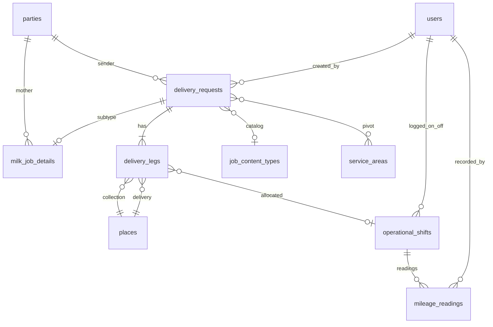

# 5NF target schema

## Summary

Target for bringing Plasma’s domain tables to fifth normal form (5NF / PJ/NF). Associations that are already 5NF-shaped stay unchanged. The work focuses on decomposing `delivery_jobs`, unifying mileage storage, and linking contents to `job_content_types` without losing historical labels.

**Implementation status:** landed. Mileage single-store (`mileage_readings.kind` = `start`\|`end`), request/leg split (`delivery_requests` + `delivery_legs`), `parties`, `milk_job_details`, and `content_type_id` + `content_label_snapshot` are in app code and migrations. API camelCase shape is unchanged.

## Scope

| In scope | Out of scope (for remaining steps) |
|----------|----------------|
| Target table predicates, keys, columns | Changing API JSON contracts |
| Mapping from current `delivery_jobs` / shift mileage | Client-visible breaking changes |
| Controlled exceptions (content snapshot, place geocode) | |

Already 5NF — keep:

- `delivery_job_service_areas` (rename conceptually to `delivery_request_service_areas`)
- `outbound_postcode_areas`, `service_areas`, `riders`, `bikes`, `users`, `job_content_types`
- `places` as an external geocode snapshot (not a join-dependency problem)
- `outbound_postcode_area_audits.changes` JSON (event log, not a domain relvar)

## Target ERD

## 1. Request vs leg split

Today one `delivery_jobs` row holds request-level facts and hop-level facts. Relay creation copies request-level columns onto each leg (`DeliveryJobService::createRelayLegs`), which yields FD `parent_job_id → shared attrs` where `parent_job_id` is not a candidate key (BCNF break).

**Rule:** every transport is a `delivery_requests` row with one or more `delivery_legs`. A non-relay job is a request with a single leg (`leg_number = 1`). Relay parents stop being a second “job” shape; the request row is the parent, legs are the only allocatable units.

### `delivery_requests`

Predicate: *one clinical/transport request*.

| Column | Type | Null | Notes |
|--------|------|------|-------|
| `id` | uuid PK | NO | |
| `reference` | varchar UK | NO | e.g. `JB-0001` (never `-Ln`) |
| `status` | varchar | NO | Overall request status (today’s parent/standalone status; still updated by `RelayJobStatusAggregator` logic) |
| `job_type` | varchar | NO | `standard` \| `milk` (default `standard`); cheap filter |
| `is_bereavement` | boolean | NO | default false |
| `sender_party_id` | uuid FK → `parties` | NO | |
| `content_type_id` | uuid FK → `job_content_types` | YES | Set when created from catalog |
| `content_label_snapshot` | text | NO | Immutable label at create (replaces `contents`) |
| `scheduled_collection_at` | timestamp | YES | Shared across all legs |
| `created_by_user_id` | uuid FK → `users` | NO | |
| `created_at` / `updated_at` | timestamp | YES | |

### `delivery_legs`

Predicate: *one hop of a request*.

| Column | Type | Null | Notes |
|--------|------|------|-------|
| `id` | uuid PK | NO | Public job id for allocate/collect/deliver (today’s leg or standalone job id) |
| `request_id` | uuid FK → `delivery_requests` | NO | Replaces `parent_job_id`; always set |
| `leg_number` | smallint | NO | `1…n`; unique with `request_id` |
| `reference` | varchar UK | NO | Standalone: same as request; relay: `{request.reference}-L{n}` |
| `status` | varchar | NO | Leg lifecycle only |
| `collection_place_id` | uuid FK → `places` | NO | |
| `delivery_place_id` | uuid FK → `places` | NO | |
| `collection_notes` | text | YES | |
| `delivery_notes` | text | YES | |
| `estimated_collection_at` | timestamp | YES | Hop timing (not copied from siblings) |
| `estimated_delivery_at` | timestamp | YES | |
| `planned_arrival_at` | timestamp | YES | Rendezvous arrival on relay |
| `operational_shift_id` | uuid FK → `operational_shifts` | YES | null on delete |
| `allocated_at` | timestamp | YES | |
| `contents_confirmed` | boolean | YES | |
| `receipt_number` | varchar | YES | |
| `collected_at` | timestamp | YES | |
| `recipient` | varchar | YES | |
| `no_recipient` | boolean | NO | default false |
| `delivered_at` | timestamp | YES | |
| `cancellation_reason` | text | YES | |
| `cancelled_at` | timestamp | YES | |
| `created_at` / `updated_at` | timestamp | YES | |

Keys / indexes:

- PK `id`
- UK `reference`
- UK `(request_id, leg_number)` (same guarantee as today’s `delivery_jobs_parent_job_id_leg_number_unique`, but always populated)

### `delivery_request_service_areas`

Same shape as today’s pivot; FK target becomes `delivery_requests.id` instead of `delivery_jobs.id`. Synced once on the request (not re-copied per leg).

### Column mapping from `delivery_jobs`

| Current `delivery_jobs` column | Target |
|--------------------------------|--------|
| `id` | `delivery_legs.id` (allocatable unit). New `delivery_requests.id` for the request header |
| `reference` | Request: base ref. Leg: base or `-Ln` |
| `status` | Both: request = aggregate/overall; leg = hop lifecycle |
| `sender_name` / `sender_phone` / `sender_organisation` | `parties` via `sender_party_id` |
| `mother_*` / `milk_litres` | `milk_job_details` (+ mother `parties`) |
| `job_type` / `is_bereavement` | `delivery_requests` |
| `contents` | `content_label_snapshot` (+ optional `content_type_id`) |
| `scheduled_collection_at` / `created_by_user_id` | `delivery_requests` |
| `collection_*` / `delivery_*` / estimates / `planned_arrival_at` | `delivery_legs` |
| `operational_shift_id` / `allocated_at` / collect / deliver / cancel fields | `delivery_legs` |
| `parent_job_id` / `leg_number` | `request_id` / `leg_number` (always set) |

### Recurring series (landed)

Predicate split: `job_recurrences` is the series template (schedule + blueprint FKs to `parties` / `places` / content); `milk_recurrence_details` is the milk subtype; `job_recurrence_service_areas` is the M:N pivot. Materialized occurrences are ordinary `delivery_requests` with `recurrence_id` + `occurrence_date` (unique together) and a single `delivery_legs` hop. Artisan `jobs:materialize-recurrences` tops up the rolling horizon.

## 2. Parties and milk subtype

### `parties`

Predicate: *a named contact used on a request*.

| Column | Type | Null |
|--------|------|------|
| `id` | uuid PK | NO |
| `name` | varchar | NO |
| `phone` | varchar | NO |
| `phone_secondary` | varchar | YES |
| `organisation` | varchar | YES |
| `created_at` / `updated_at` | timestamp | YES |

No global uniqueness on phone/name (same person may be entered afresh per request). Deduping contacts is explicitly out of scope for 5NF.

### `milk_job_details`

Predicate: *milk-specific attributes of a request*.

| Column | Type | Null |
|--------|------|------|
| `delivery_request_id` | uuid PK/FK → `delivery_requests` | NO |
| `milk_litres` | numeric(5,2) | NO |
| `mother_party_id` | uuid FK → `parties` | NO |

Constraints (committed):

1. Keep `delivery_requests.job_type` for filtering.
2. Enforce: `job_type = 'milk'` **iff** a `milk_job_details` row exists (DB trigger or deferred check).
3. Forbid `milk_litres` / mother fields on non-milk requests by absence of the subtype table (no nullable milk columns on the request row).

## 3. Contents catalog + snapshot

| Mechanism | Role |
|-----------|------|
| `job_content_types` | Editable catalog (unchanged) |
| `content_type_id` | Normalized link when the picker value is known |
| `content_label_snapshot` | Historical label; survives rename/retire |

Controlled redundancy: snapshot duplicates the catalog name at create time. Pure 5NF would store only the FK; Plasma keeps the snapshot so completed jobs remain readable after catalog edits (matches current API note on `PATCH /api/job-contents/{id}`).

## 4. Mileage single source of truth

Today log-off writes `operational_shifts.end_mileage` and a 1:1 `mileage_readings` row with the same number. Start mileage lives only on the shift.

### Remove from `operational_shifts`

- `start_mileage`
- `end_mileage`
- `end_mileage_reason` (moves onto the end reading’s `reason`)
- Keep `mileage_variance_reason` only if it describes the logon event independently; prefer storing that text on the **start** reading’s `reason` and drop the shift column when implementing

### `mileage_readings` (revised)

Predicate: *one odometer observation for a shift*.

| Column | Type | Null | Notes |
|--------|------|------|-------|
| `id` | uuid PK | NO | |
| `operational_shift_id` | uuid FK → `operational_shifts` | NO | |
| `kind` | varchar | NO | `start` \| `end` |
| `mileage` | integer | NO | |
| `reason` | text | YES | Start: variance vs bike current; end: silly-distance explanation |
| `recorded_at` | timestamp | NO | |
| `recorded_by_user_id` | uuid FK → `users` | NO | |
| `created_at` / `updated_at` | timestamp | YES | |

Keys:

- UK `(operational_shift_id, kind)` — replaces today’s UK on `operational_shift_id` alone
- Check: `kind IN ('start', 'end')`
- Bike without mileage (optional bike on shift): no `start`/`end` readings (same as today’s null start/end)

`Bike::currentMileage()` continues to read the latest `mileage_readings` row (any kind), so bike log behaviour stays intact.

## 5. API compatibility (flat JSON)

Clients (Plasma Controller) must not need to know about the split. Presenters keep today’s camelCase shapes.

### Jobs — [`DeliveryJobResource`](../../app/Http/Resources/DeliveryJobResource.php)

| JSON field | Reads from |
|------------|------------|
| `id`, `reference`, `status`, leg lifecycle blocks | `delivery_legs` (the row being shown) |
| `jobType`, `isBereavement`, `scheduledCollectionAt`, `contents` | `delivery_requests` (+ snapshot) |
| `milkLitres`, `mother` | `milk_job_details` + mother `parties` |
| `sender` | sender `parties` |
| `isRelay` | `request.legs_count > 1` |
| `parentJobId` | For a leg in a multi-leg request: expose request id **or** keep compatibility by exposing the first/header id the SPA already treats as parent — prefer mapping `parentJobId` → `request_id` when `legs_count > 1` and this is not a synthetic “list as request” row |
| `legNumber` | `delivery_legs.leg_number` |
| `legs` | Sibling legs when serializing the request aggregate |
| `serviceAreas` | `delivery_request_service_areas` |
| Places / allocation / collect / deliver / cancel | `delivery_legs` |

List endpoints (`GET /api/jobs/{scope}`) continue to return **top-level** items: one resource per request for multi-leg (with nested `legs`), and the single leg flattened as today for one-leg requests — same outward shape as current parent-vs-standalone listing.

Action routes (`allocate` / `collect` / `deliver` / `cancel`) keep taking a leg (or request) uuid; services load the leg and its request instead of one wide model.

### Shifts — [`ActiveShiftResource`](../../app/Http/Resources/ActiveShiftResource.php)

| JSON field | Reads from |
|------------|------------|
| `startMileage` | `mileage_readings` where `kind = 'start'` |
| `mileageVarianceReason` | that start reading’s `reason` (or retained shift column until dropped) |
| Other fields | `operational_shifts` unchanged |

Logon/logoff request bodies (`startMileage`, `endMileage`) stay the same; `OperationalShiftService` writes readings instead of shift mileage columns.

### Bike directory

`mileageHistory` / `lastRecordedMileage` already come from `mileage_readings`; after the change they include start and end kinds (still chronological by `recorded_at`).

## Implementation order

1. ~~Mileage `kind` + drop shift mileage columns~~
2. ~~Request / leg split + pivot retarget~~
3. ~~`parties` + `milk_job_details`~~
4. ~~`content_type_id` beside snapshot~~

## Related code

- [`app/Models/DeliveryJob.php`](../../app/Models/DeliveryJob.php)
- [`app/Services/Jobs/DeliveryJobService.php`](../../app/Services/Jobs/DeliveryJobService.php)
- [`app/Services/Shifts/OperationalShiftService.php`](../../app/Services/Shifts/OperationalShiftService.php)
- [`app/Models/MileageReading.php`](../../app/Models/MileageReading.php)
- [`app/Models/Bike.php`](../../app/Models/Bike.php) (`currentMileage`)
- Migrations under `database/migrations/` for `delivery_jobs`, operational shifts, `job_content_types`
